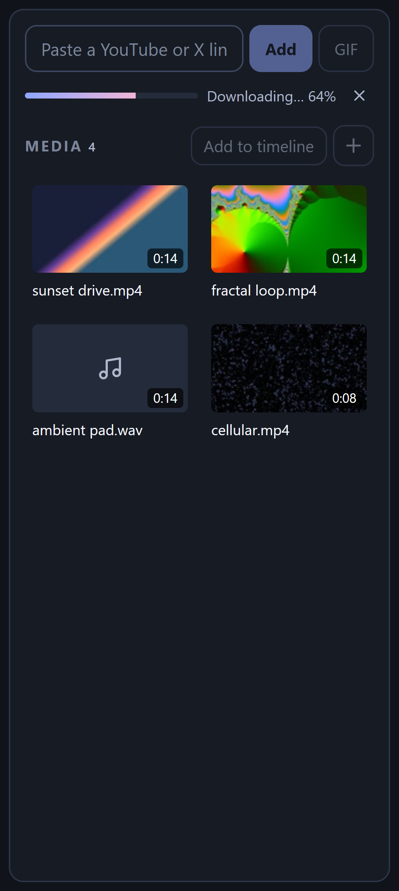
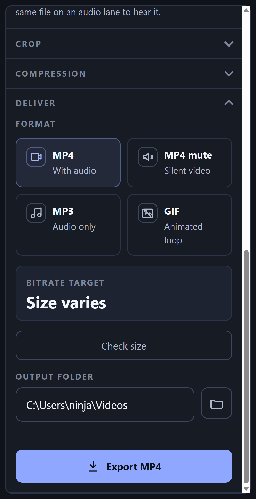

# DAXIL

A small, fast desktop video editor in the spirit of DaVinci Resolve — media pool on the left, preview in the middle, inspector on the right, and a multi-track timeline across the bottom. Trim, stack, compress and export local video, or paste a YouTube / X link and have it land on the timeline ready to cut.

Built with Electron, React, TypeScript and FFmpeg. Everything runs on your machine.

<p align="center">
  
</p>

## Highlights

- **Resolve-lite layout.** Media pool → preview → inspector, with the timeline spanning the full width underneath. Drag the divider to resize the timeline.
- **Paste a link.** Drop a YouTube, X/Twitter or other video URL into the link box (or just press Ctrl+V anywhere). It downloads, joins the media pool and is added to the end of the timeline. Or press **GIF** to turn the link straight into a GIF with no editing step.
- **Stack video.** Drop a clip onto V2 or above to layer it over V1. Drag it around the preview, resize it from the corner, set opacity, fill the frame — picture-in-picture without a filter graph in sight.
- **Edit with your hands.** Trim by dragging clip edges, split at the playhead, rubber-band select across tracks, drag groups, undo everything.
- **Zoom that stays put.** Ctrl+wheel or pinch zooms around the cursor; the buttons zoom around the playhead.
- **Deliver.** MP4, silent MP4, MP3 or GIF, with bitrate-targeted compression presets, cropping, speed, and a "Check size" that encodes a real sample so the number is exact.
- **Small install.** The Windows installer ships one FFmpeg and one FFprobe, nothing else. The link downloader (yt-dlp) is fetched on first use, not bundled.

## Tour

### Import



Three ways in, all of which also work when nothing is loaded yet:

- **Drop files anywhere** in the window. The first video becomes the project; everything else goes to the media pool. Drop onto the timeline to place clips exactly there.
- **Import** with the `+` button or **Ctrl+I**. Multi-select works.
- **Paste a link.** The box accepts anything [yt-dlp](https://github.com/yt-dlp/yt-dlp) can read. **Add** (or Enter) downloads and appends it to V1. **GIF** downloads and encodes the whole clip to a GIF you choose a location for.

The media pool is a thumbnail grid: click, Ctrl-click or Shift-click to select several, then drag them to the timeline together, press Enter, or use the hover `+` on a tile. Delete removes unused assets.

<br clear="right" />

### Timeline

<p align="center">
  
</p>

- **V1** is the sequence: clips play back to back, and dragging a clip moves it to a new slot. Dropping video onto V1 inserts at the nearest boundary.
- **V2, V3…** are free tracks. Dropping video there creates a stacked clip at that time. Higher tracks draw on top. The `●` next to a track name hides it from the preview and the export.
- **A1, A2…** hold audio clips mixed over the video's own soundtrack.
- Drag clip edges to trim. Press **I** / **O** to trim to the playhead, **S** to split, **Delete** to remove.
- Drag on empty space to rubber-band select across video, stacked and audio clips. Shift adds to the selection. Ctrl+A selects everything.
- Right-click a clip for Duplicate, Move, Reset trim, Fill frame and more.
- Click or drag on the ruler to scrub. Ctrl+wheel or pinch to zoom around the cursor; a plain wheel scrolls.

### Stacked clips (picture-in-picture)

Select a stacked clip and the inspector shows its **Transform**: size, X/Y, opacity, plus **Fill frame** and **Reset**. You can also drag the clip directly in the preview and resize it from the bottom-right handle. Stacked clips are picture-only — drop the same file onto an audio lane if you want its sound too.

<p align="center">
  
</p>

### Deliver



The **Deliver** section at the bottom of the inspector is the export page.

- **Format:** MP4 with audio, silent MP4, MP3, or an animated GIF (choose width and frame rate; **Preview GIF** renders a quick sample).
- **Compression:** five presets from high quality (CRF 18) to a 90 % size reduction. Percentages are bitrate targets, so **Check size** encodes a temporary file and reports the actual byte count. Any edit invalidates it.
- **Crop:** toggle the crop frame and drag it in the preview, or use the sliders.
- **Speed:** the toolbar's `1×` menu changes playback rate for the export as well.

Export opens a save dialog, shows progress with the FFmpeg log, and offers to open the output folder when done. The one-click **GIF** button in the link box uses the same pipeline.

<br clear="right" />

### Themes

Four dark and four light themes, chosen from the header.

| | |
|---|---|
|  |  |
|  |  |

## Keyboard shortcuts

| Keys | Action |
|---|---|
| Space / click preview | Play / pause |
| I / O | Set in / out point at the playhead |
| S | Split at the playhead |
| Delete / Backspace | Remove selected clips |
| Ctrl+Z / Ctrl+Shift+Z / Ctrl+Y | Undo / redo |
| Ctrl+A | Select everything on the timeline |
| Ctrl+I | Import media |
| Ctrl+V | Paste a video link (when not typing in a field) |
| = / − / \ | Zoom in / out / fit |
| Ctrl+wheel, pinch | Zoom around the cursor |
| Esc | Clear selection, cancel a trim or close a menu |
| ← / → on a trim handle | Nudge one frame (Shift: ten) |

## Installation

Installers and archives are published on the GitHub Releases page:

https://github.com/andrewporasl/DAXIL/releases

Use the asset that matches the target platform:

- macOS Apple Silicon: `DAXIL-<version>-mac-arm64.dmg`
- Windows: `DAXIL-<version>-win-x64.exe`
- Linux: `DAXIL-<version>-linux-x86_64.AppImage`

The source code archives generated by GitHub are not application installers. Platform notes, including the unsigned-build prompts, are in [docs/INSTALLATION.md](docs/INSTALLATION.md).

Release builds bundle FFmpeg and FFprobe for the target platform only, so no runtime setup is needed. The first time you paste a link, DAXIL downloads the current [yt-dlp](https://github.com/yt-dlp/yt-dlp) release into its app-data folder; you can point it at your own copy, or update it, from **Settings**.

## Development

Requires Node.js 18 or newer.

```bash
npm install
npm run dev          # Electron with hot reload
npm run lint         # TypeScript checks for renderer and main
npm test             # unit tests, including real FFmpeg exports
npm run test:ui      # drives the built app in an offscreen Electron window
npm run screenshots  # regenerates resources/showcase/*.png from synthetic footage
```

Packaging:

```bash
npm run package          # current platform
npm run package:win      # NSIS installer + zip
npm run package:mac      # dmg + zip (add :arm64 for Apple Silicon)
npm run package:linux    # AppImage + tar.gz
```

Artifacts land in `dist/`. `npm run test:packaged` launches the unpacked Windows build with an isolated profile and verifies the bundled binaries, a real export and the preview protocol. Tagged releases are built by GitHub Actions; see [docs/RELEASE_PROCESS.md](docs/RELEASE_PROCESS.md).

## Architecture

```text
DAXIL/
├── main/
│   ├── index.ts          Electron entry, window creation, safe-file:// range-capable protocol
│   ├── ipc.ts            IPC: dialogs, metadata, thumbnails, export, measure, settings, downloads
│   ├── preload.ts        contextBridge API (window.electronAPI)
│   ├── ffmpeg.ts         Export graph: trim/concat sequence, audio mix, overlays, crop, speed, GIF palette
│   ├── ffmpegGraph.ts    Pure builder for the stacked-video overlay chain (unit tested)
│   ├── ffprobe.ts        Source metadata
│   ├── downloader.ts     yt-dlp acquisition, updates and link downloads with progress
│   ├── downloaderCore.ts URL validation, argv construction, progress and error parsing
│   ├── binaries.ts       Bundled / user-overridden FFmpeg and FFprobe resolution
│   └── output.ts         Output path validation
├── renderer/src/
│   ├── App.tsx           Project state: clips, stacked clips, audio, history, import and link flows
│   ├── app.css           Theme variables and the editor shell styles
│   ├── components/
│   │   ├── Editor.tsx    The editing surface: preview + PiP layers, transport, ruler, tracks, zoom, marquee
│   │   ├── Lanes.tsx     Free-positioned lanes for stacked video and audio clips
│   │   ├── MediaPool.tsx Thumbnail grid with multi-select and drag
│   │   ├── LinkBox.tsx   Paste-a-link entry with progress
│   │   ├── Inspector.tsx Clip details and transform, crop, compression, deliver
│   │   ├── ExportPanel.tsx, CropPanel.tsx, CompressionPresets.tsx, ProgressPanel.tsx, ResultPanel.tsx
│   │   └── SettingsModal.tsx
│   └── lib/
│       ├── clips.ts      Sequence editing helpers (trim, split, move, select)
│       └── timeline.ts   Zoom anchoring, ruler steps, multi-asset insertion, drag payloads
├── shared/               Types and the export size plan shared by both processes
├── scripts/              Icon generation and README screenshot capture
└── tests/                Node unit tests, Electron UI test, packaged smoke test
```

## Implementation notes

- Export builds one FFmpeg filter graph: each V1 clip is trimmed, normalised to the primary frame size and concatenated; stacked clips are scaled and composited with `overlay` in track order (with `colorchannelmixer` for opacity); audio lanes are delayed and mixed over the sequence; crop, speed and GIF palette generation apply to the composite. Measure and export share this graph, so "Check size" is exact.
- Compression percentages are bitrate targets derived from the source size, subject to the encoder's 200 kb/s video floor. CRF and GIF outputs have content-dependent sizes.
- Local preview streams through a custom `safe-file://` protocol with HTTP range support so seeking works on large files and paths with spaces or `%` characters.
- Zoom keeps an anchor time fixed on screen by correcting the scroll position in a layout effect after the new width has been committed.
- Links are validated to `http(s)` before anything is spawned, and are passed to yt-dlp as a single argument after `--`.

## Privacy

DAXIL is a local desktop application. Your media never leaves your machine. The only network access is:

- fetching yt-dlp from GitHub the first time you use the link box (or when you press Update in Settings), and
- the links you choose to paste, which yt-dlp downloads directly from the site.

No accounts, telemetry or hosted services.

## Code signing

Current public builds are unsigned. macOS may show the standard first-run warning; open the app via right-click → Open, or **System Settings → Privacy & Security → Open Anyway**. Windows SmartScreen may ask you to confirm the first launch.

## License

MIT — see [LICENSE](LICENSE).
