<div align="center">


# DAXIL

**Desktop video editor and compressor.**<br />
Trim, stack, crop, compress and export video, or paste a link from YouTube, TikTok, SoundCloud and 1,000+ other sites.<br />
Runs entirely on your machine.

[](https://github.com/andrewporasl/DAXIL/releases/latest)
[](https://github.com/andrewporasl/DAXIL/releases)
[](https://github.com/andrewporasl/DAXIL/actions/workflows/release.yml)
<br />
[](#download)
[](https://github.com/andrewporasl/DAXIL/blob/main/package.json)
[](https://ffmpeg.org)


[Download](https://github.com/andrewporasl/DAXIL/releases) · [Features](#features) · [Showcase](#showcase) · [Updates](#updates) · [Contributing](#contributing)

<br />

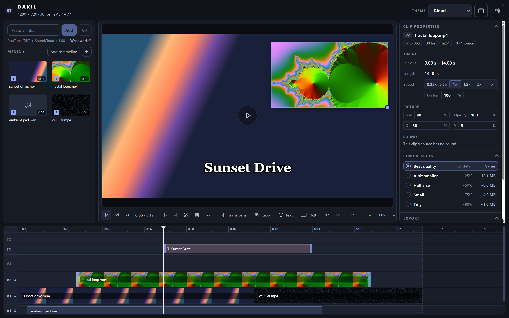

</div>

## Features

- **Import** by dropping files, `Ctrl+I`, or pasting a link (`Ctrl+V` anywhere).
- **Phone and pro formats.** iPhone HEVC/HDR `.mov` (portrait handled), ProRes and Motion JPEG get a temporary preview copy automatically; export always uses the original.
- **Links** from any site [yt-dlp](https://github.com/yt-dlp/yt-dlp/blob/master/supportedsites.md) supports: YouTube, TikTok, Instagram, X, Reddit, Twitch, Vimeo, SoundCloud, Bandcamp and more. Each link asks: **add to media pool** to edit it, or **convert and save** it straight to MP4, MP3 or GIF in its own folder (set in Settings). **GIF** in the link box is a one-click shortcut.
- **Temporary downloads.** Link downloads are deleted when you remove them, close the window, or choose **Delete** after export. Imported files are never touched.
- **Multi-track timeline.** Free-form video and audio tracks, gaps, snapping, trim, split, rubber-band select, undo.
- **Picture-in-picture.** Higher tracks draw on top; move, resize and fade clips in the preview or with the Transform strip.
- **Crop** with ratio presets (16:9, 1:1, 9:16, 4:5) or free-form.
- **Canvas** of any size: landscape, portrait, square, 4:5, match a clip, or custom. Change it any time.
- **Compression** presets from best quality to −90 %, with estimated sizes and an exact-size check.
- **Export** MP4, silent MP4, MP3 or GIF, with speed control. **Preview 5s** renders a real sample of the export first.
- **Small install.** Bundles FFmpeg and FFprobe only; yt-dlp is fetched on first use.
- **Clip properties.** Select any clip, or one piece of a split clip, to see its source details and set its own speed (0.1×–16×, multiplied by the project speed), size, position, opacity and gain in dB (−40 to +12, heard live in the preview), or mute it.
- **Text overlays.** Titles on their own text tracks with eight basic fonts, size, colour, bold/italic, alignment and shadow, outline or box styles. What you see in the preview is exactly what's exported.
- **Snapping in the preview.** Layers and text snap to the canvas edges and centre lines, with guides (hold Alt to place freely).
- **Copy and paste clips.** `Ctrl+C` / `Ctrl+X` / `Ctrl+V` on the timeline; pasted clips land at the playhead.
- **Sound-only exports.** A timeline with only audio exports as MP3, and you can start a project from a song alone.
- **Updates itself.** New versions download inside the app; see [Updates](#updates).
- **Know where things are.** Settings lists every storage location (exports, temporary downloads, settings, tools) with a button to open each.

## Showcase

<div align="center">

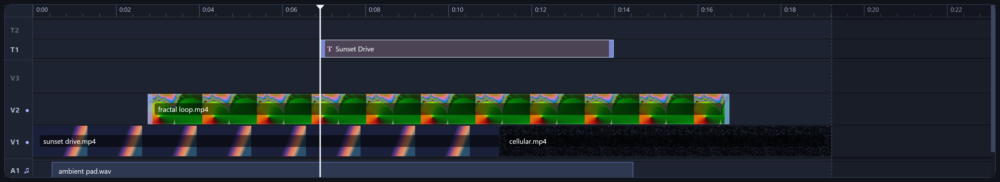<br />
<sub><b>Multi-track timeline</b> · free-form video, audio and text tracks, picture-in-picture, snapping</sub>

<br /><br />

<table>
  <tr>
    <td align="center" valign="middle" width="50%">
      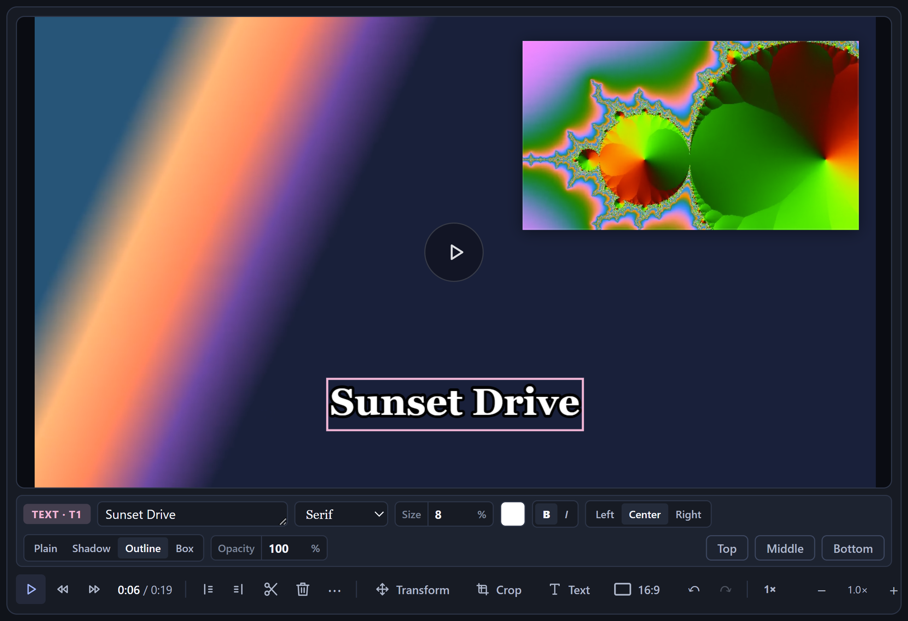<br />
      <sub><b>Text overlays</b><br />Eight fonts, outline, shadow or box, exported exactly as previewed</sub>
    </td>
    <td align="center" valign="middle" width="50%">
      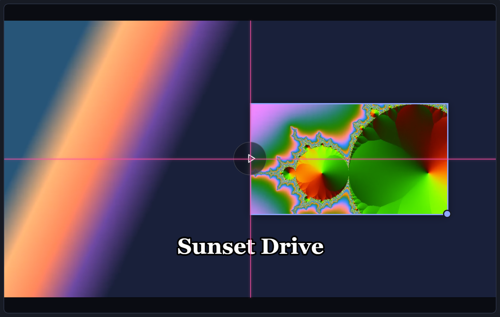<br />
      <sub><b>Canvas snapping</b><br />Layers and text snap to edges and centre lines</sub>
    </td>
  </tr>
</table>

<br />

<table>
  <tr>
    <td align="center" valign="middle" width="33%">
      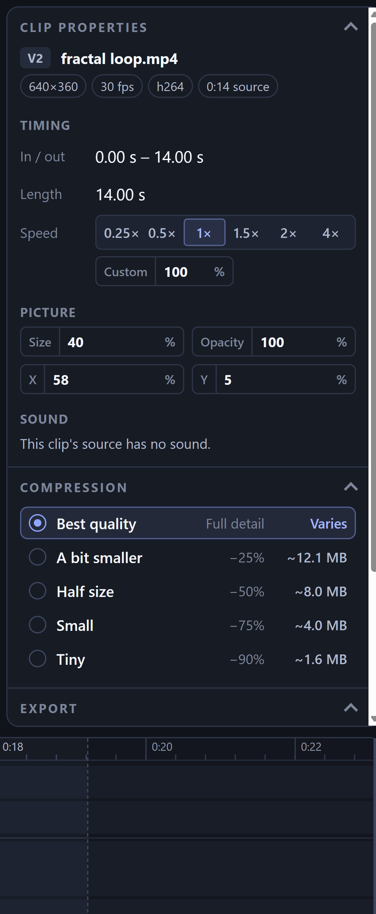<br />
      <sub><b>Compression &amp; export</b><br />Presets with size estimates, MP4 / MP3 / GIF</sub>
    </td>
    <td align="center" valign="middle" width="33%">
      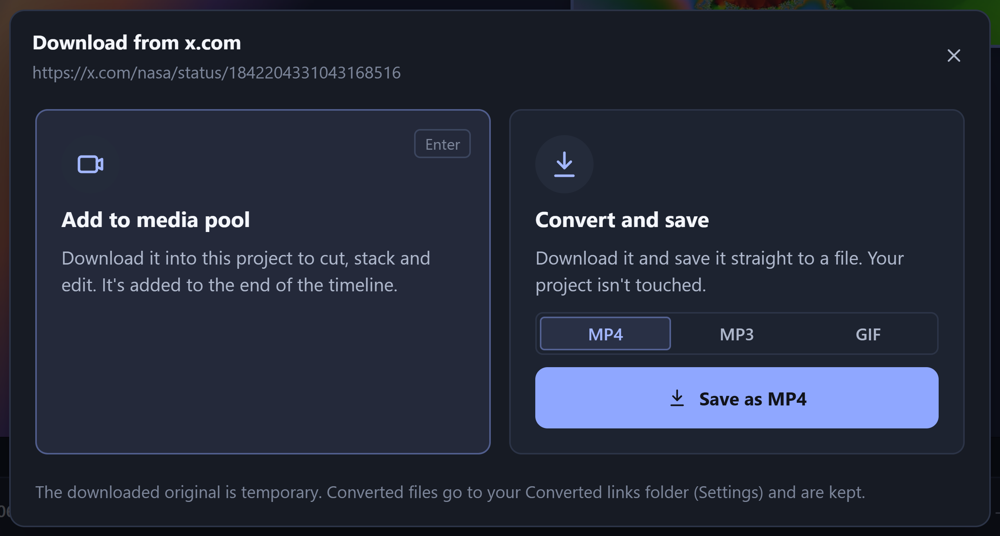<br />
      <sub><b>Paste a link</b><br />Edit it, or convert it straight to a file</sub>
    </td>
    <td align="center" valign="middle" width="33%">
      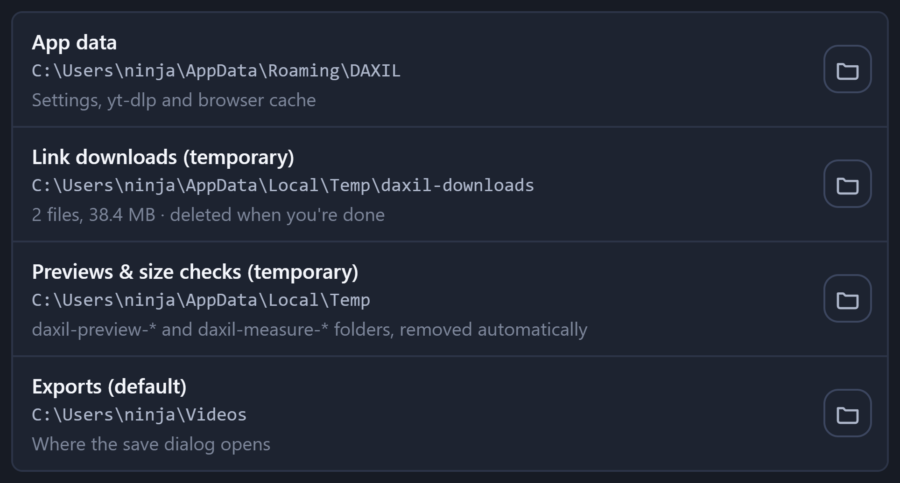<br />
      <sub><b>Storage</b><br />Every file location, one click to open</sub>
    </td>
  </tr>
  <tr>
    <td align="center" valign="middle" colspan="3">
      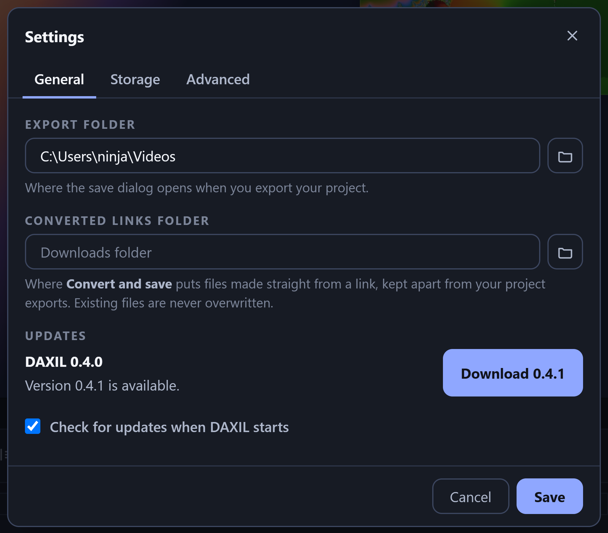<br />
      <sub><b>Updates</b><br />New versions download and install from inside the app</sub>
    </td>
  </tr>
</table>

<br />

<table>
  <tr>
    <td align="center">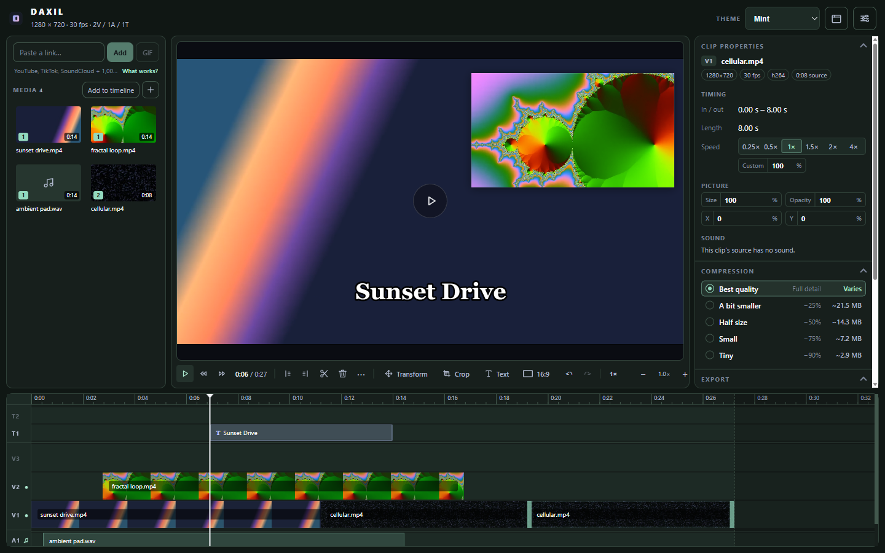<br /><sub>Mint</sub></td>
    <td align="center">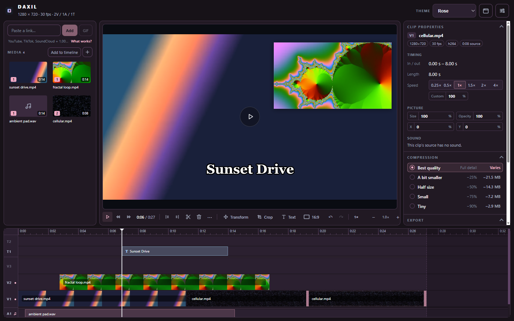<br /><sub>Rose</sub></td>
  </tr>
  <tr>
    <td align="center">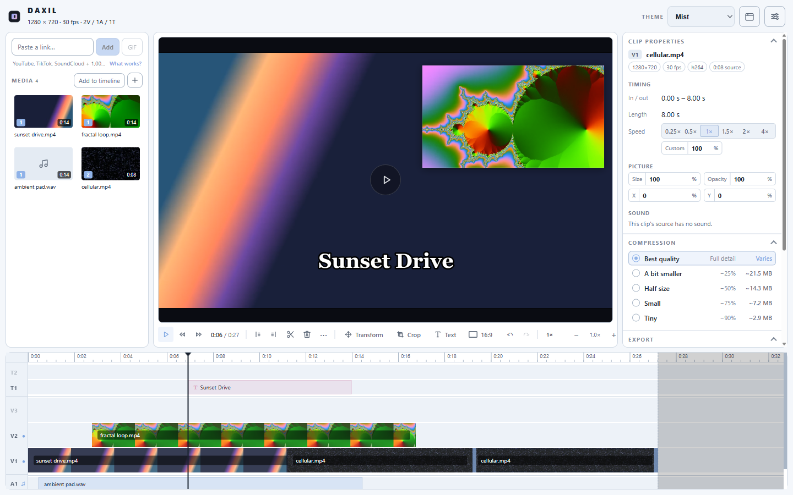<br /><sub>Mist</sub></td>
    <td align="center">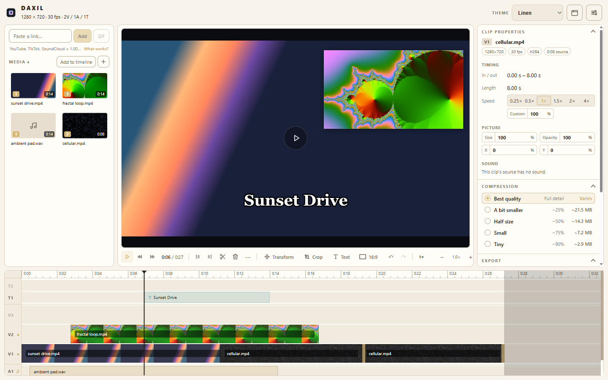<br /><sub>Linen</sub></td>
  </tr>
</table>

<sub>Four dark and four light themes, chosen from the header.</sub>

</div>

## Download

Get the installer for your platform from [Releases](https://github.com/andrewporasl/DAXIL/releases):

- Windows: `DAXIL-<version>-win-x64.exe`
- macOS (Apple Silicon): `DAXIL-<version>-mac-arm64.dmg`
- Linux: `DAXIL-<version>-linux-x86_64.AppImage`

Builds are unsigned: on macOS use right-click → Open (or **System Settings → Privacy & Security → Open Anyway**); on Windows, confirm the SmartScreen prompt. More in [docs/INSTALLATION.md](docs/INSTALLATION.md).

You only need this page once: after that, DAXIL updates from inside the app.

## Updates

DAXIL checks for a new version a few seconds after it starts (you can turn this off) and whenever you press **Check now** in **Settings → General → Updates**. There's no need to come back to GitHub:

1. When a newer version exists, a **Update available** button appears in the top bar.
2. Click it, then **Download**. The download runs in the background while you keep editing.
3. When it's done, click **Restart and update**. DAXIL closes, installs the new version and reopens. If you'd rather not restart now, it installs the next time you quit.

| How you installed DAXIL | What happens |
|---|---|
| Windows installer (`.exe`) | Downloads and installs itself, as above. |
| Linux AppImage | Downloads and replaces the AppImage, as above. |
| macOS (`.dmg`) | Tells you a new version is out and opens the download. macOS only lets signed apps replace themselves, and DAXIL builds aren't signed yet. |
| Windows ZIP or Linux tarball | Tells you a new version is out and opens the download, since these copies have no installer to update. |

**How it works.** Each release on GitHub includes small `latest.yml`, `latest-mac.yml` and `latest-linux.yml` files that name the newest version and the checksum of each installer. The app reads the one for your platform with [electron-updater](https://www.electron.build/auto-update), compares versions, and downloads the new installer straight from the release. The download is checked against that checksum before anything is installed. Your projects, settings and exports are untouched by an update.

## Keyboard shortcuts

| Keys | Action |
|---|---|
| Space / click preview | Play / pause |
| I / O | Set in / out point at the playhead |
| S | Split at the playhead |
| Delete / Backspace | Remove selected clips |
| Ctrl+Z / Ctrl+Shift+Z / Ctrl+Y | Undo / redo |
| Ctrl+D | Duplicate the selection after itself |
| ← / → (Shift: ×10) | Nudge the selection a frame, or step the playhead when nothing is selected |
| ↑ / ↓ | Move the selection up / down a track |
| Home / End | Jump to the start / end |
| Ctrl+A | Select everything on the timeline |
| Ctrl+I | Import media |
| T | Add a text overlay at the playhead |
| Ctrl+C / Ctrl+X | Copy / cut the selected clips |
| Ctrl+V | Paste copied clips at the playhead, or a video link you copied (when not typing in a field) |
| Alt while dragging | Turn off snapping |
| = / − / \ | Zoom in / out / fit |
| Ctrl+wheel, pinch | Zoom around the cursor |
| Esc | Clear selection, cancel a drag or close a menu |

## Privacy

Your media never leaves your machine. Network access is limited to fetching yt-dlp from GitHub on first use (or when you press **Update** in Settings), the links you paste, and checking GitHub Releases for a new DAXIL version (which you can turn off in Settings). The update check sends nothing about you or your files. No accounts, no telemetry.

## Contributing

Issues and pull requests are welcome. Run `npm run lint`, `npm test` and `npm run test:ui` before opening a PR; if the UI changes, regenerate the README images with `npm run screenshots`.

### Development

Requires Node.js 18 or newer.

```bash
npm install
npm run dev          # Electron with hot reload
npm run lint         # TypeScript checks for renderer and main
npm test             # unit tests, including real FFmpeg exports
npm run test:ui      # drives the built app in an offscreen Electron window
npm run screenshots  # regenerates resources/showcase/*.png from synthetic footage
```

Packaging:

```bash
npm run package          # current platform
npm run package:win      # NSIS installer + zip
npm run package:mac      # dmg + zip (add :arm64 for Apple Silicon)
npm run package:linux    # AppImage + tar.gz
```

Artifacts land in `dist/`. `npm run test:packaged` launches the unpacked Windows build with an isolated profile and verifies the bundled binaries, a real export and the preview protocol. Tagged releases are built by GitHub Actions; see [docs/RELEASE_PROCESS.md](docs/RELEASE_PROCESS.md).

### Architecture

```text
DAXIL/
├── main/
│   ├── index.ts          Electron entry, window creation, safe-file:// range-capable protocol
│   ├── ipc.ts            IPC: dialogs, metadata, thumbnails, export, measure, settings, downloads
│   ├── preload.ts        contextBridge API (window.electronAPI)
│   ├── ffmpeg.ts         Export: timeline graph, then crop, speed, GIF palette / MP3 / MP4 encode
│   ├── ffmpegGraph.ts    Pure builder: every video track composited over black, every sounding clip mixed (unit tested)
│   ├── ffprobe.ts        Source metadata
│   ├── downloader.ts     yt-dlp acquisition, updates and link downloads with progress
│   ├── tempDownloads.ts  Per-window temporary download folder; deletes only files it downloaded
│   ├── downloaderCore.ts URL validation, argv construction, progress and error parsing
│   ├── binaries.ts       Bundled / user-overridden FFmpeg and FFprobe resolution
│   └── output.ts         Output path validation
├── renderer/src/
│   ├── App.tsx           Project state: clips on free tracks, media, history, import and link flows
│   ├── app.css           Theme variables and the editor shell styles
│   ├── components/
│   │   ├── Editor.tsx    The editing surface: layered preview, playback clock, ruler, drag/trim/snap, zoom, marquee
│   │   ├── Tracks.tsx    Rows of free-positioned clips for video and audio tracks
│   │   ├── MediaPool.tsx Thumbnail grid with multi-select and drag
│   │   ├── LinkBox.tsx   Paste-a-link entry, supported-sites list, progress
│   │   ├── ToolStrip.tsx Transform and crop strips on the preview toolbar
│   │   ├── CanvasMenu.tsx Canvas size: presets, match a clip, custom
│   │   ├── PreviewModal.tsx 5-second export preview player
│   │   ├── Inspector.tsx Compression and export
│   │   ├── ExportPanel.tsx, CompressionPresets.tsx, ProgressPanel.tsx, ResultPanel.tsx
│   │   └── SettingsModal.tsx
│   └── lib/
│       ├── edit.ts       Timeline model helpers: trim, split, move, snap, select, insert, remove
│       ├── timeline.ts   Zoom anchoring, ruler steps, drag payloads
│       └── linkSites.ts  The supported-sites list shown in the app
├── shared/               Types and the export size plan shared by both processes
├── scripts/              Icon generation and README screenshot capture
└── tests/                Node unit tests, Electron UI test, packaged smoke test
```

### Implementation notes

- Export builds one FFmpeg filter graph: a black canvas the length of the timeline, every video clip trimmed and composited with `overlay` in track order (full-frame clips letterboxed, others scaled, `colorchannelmixer` for opacity, `enable` for its time range), and every sounding clip delayed and mixed over silence. Crop, speed and GIF palette generation apply to the composite. Measure, preview and export share this graph, so "Get exact" is exact and the 5-second preview (the timeline sliced to that window) looks exactly like the export.
- Playback is driven by a single clock; each visible clip is its own `<video>` layer kept within a fraction of a second of that clock, so stacked clips and gaps preview exactly as they export.
- Compression percentages are bitrate targets derived from the source size, subject to the encoder's 200 kb/s video floor. CRF and GIF outputs have content-dependent sizes.
- Local preview streams through a custom `safe-file://` protocol with HTTP range support so seeking works on large files and paths with spaces or `%` characters.
- Zoom keeps an anchor time fixed on screen by correcting the scroll position in a layout effect after the new width has been committed.
- Links are validated to `http(s)` before anything is spawned, and are passed to yt-dlp as a single argument after `--`.

## License

MIT — see [LICENSE](LICENSE).
